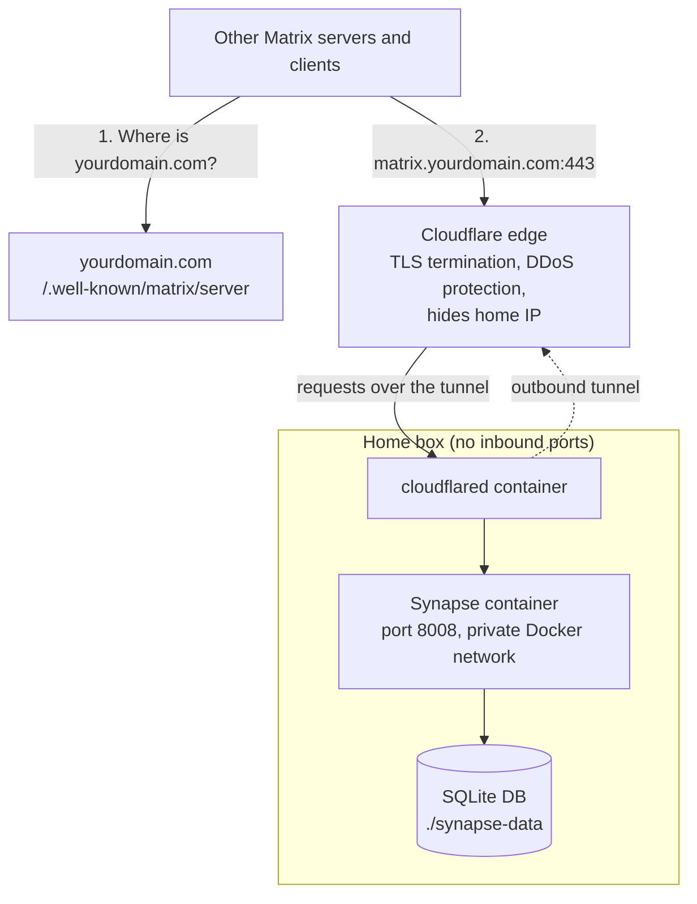

Self-hosted Matrix (Synapse) on an always-on Linux box at home, fronted by a Cloudflare tunnel. Closed registration (admin-created users only). SQLite database. Hermes Agent connects to it as a chat platform.

This guide combines the original setup runbook and its quick-reference cheatsheet. Part 1 is first-time setup. Part 2 is the daily-use reference.

## Part 1: Setup

### Architecture



**Why Cloudflare tunnel:** residential ISPs often use CGNAT (no port forwarding), give you a dynamic IP, and your home IP would otherwise be visible to every federated server. The tunnel is outbound-only from your home, with no exposed ports.

**Why SQLite:** fine for 1–5 users, no separate database container to manage, and the whole database is one file. Migrating to Postgres later is straightforward (Synapse's `synapse_port_db` script does the conversion).

**Names used in this guide:**

| Name | Meaning |
|---|---|
| `yourdomain.com` | Your **server name**. User IDs look like `@<username>:yourdomain.com`. |
| `matrix.yourdomain.com` | The host where Synapse is actually reachable, through the tunnel. |

Other servers find `matrix.yourdomain.com` from `yourdomain.com` through **delegation** (Step 3). If you would rather skip delegation, use `matrix.yourdomain.com` as the server name too; user IDs then look like `@<username>:matrix.yourdomain.com`.

### Prerequisites

1. **A domain you own.** Any registrar works.
2. **The domain on Cloudflare** with Cloudflare's nameservers. The free tier is fine.
3. **An always-on Linux box at home** running Docker and Docker Compose v2: a mini PC, a Raspberry Pi 4/5, or a NAS that runs Docker. (Not the VPS: the point is to keep chat at home.)
4. **Outbound access** from the home box to Cloudflare (port 7844) and to the internet over HTTPS. No inbound ports.
5. **A way to serve two small files on `https://yourdomain.com`** (any website on the apex domain), for delegation. Skip this if you use `matrix.yourdomain.com` as the server name.

### Step 1: Move the domain to Cloudflare (if not already there)

If your domain is already on Cloudflare, skip to Step 2.

1. Sign up at dash.cloudflare.com (free).
2. "Add a site" → enter your domain → Cloudflare scans existing DNS records.
3. Cloudflare gives you two nameserver addresses.
4. At your registrar, change the domain's nameservers to the two Cloudflare ones.
5. Wait. Propagation usually takes under an hour, sometimes up to 24.

**Important:** while migrating, keep your existing DNS records working. Review the imported list before activating.

### Step 2: Create the Cloudflare tunnel

1. Zero Trust → Networks → Tunnels → "Create a tunnel" → "Cloudflared" → name it (e.g. `matrix-home`).
2. Copy the **tunnel token**. Treat it like a password: anyone with it can run your tunnel.
3. Add a **public hostname** to the tunnel:
   - **Subdomain:** `matrix`
   - **Domain:** your domain
   - **Service type:** HTTP
   - **URL:** `synapse:8008` (the service name in the Compose file below)
4. Save. Cloudflare creates the `matrix` CNAME record for you.

### Step 3: Delegation (so other servers can find you)

Federating servers look up `https://yourdomain.com/.well-known/matrix/server` to learn where your Synapse lives. Serve these two files on your apex website, with `Content-Type: application/json`:

`/.well-known/matrix/server`:

```json
{ "m.server": "matrix.yourdomain.com:443" }
```

`/.well-known/matrix/client` (lets Element find the server when you sign in as `@<username>:yourdomain.com`):

```json
{ "m.homeserver": { "base_url": "https://matrix.yourdomain.com" } }
```

The client file also needs the header `Access-Control-Allow-Origin: *` so web clients can read it.

> **Why not an SRV record?** With SRV delegation, other servers still send requests addressed to `yourdomain.com` and expect a TLS certificate for `yourdomain.com` at the target. The tunnel only answers for `matrix.yourdomain.com`, so SRV-based federation fails. `.well-known` delegation does not have this problem.

### Step 4: Generate the Synapse config

On the home box:

```bash
mkdir -p ~/matrix && cd ~/matrix
docker run --rm -v "$(pwd)/synapse-data:/data" \
  -e SYNAPSE_SERVER_NAME=yourdomain.com \
  -e SYNAPSE_REPORT_STATS=no \
  matrixdotorg/synapse:latest generate
```

This creates `homeserver.yaml`, a signing key, and random secrets (including `macaroon_secret_key` and `registration_shared_secret`) in `./synapse-data/`.

**The server name is permanent.** You cannot change it later without starting over.

### Step 5: Customize `homeserver.yaml`

Edit `synapse-data/homeserver.yaml`:

```yaml
#Public base URL clients see
public_baseurl: https://matrix.yourdomain.com/

#Closed registration: only the admin creates users
enable_registration: false

#Cloudflare terminates TLS. Synapse serves plain HTTP on port 8008 (the default)
#and must trust the X-Forwarded-For header from cloudflared.
listeners:
  - port: 8008
    type: http
    tls: false
    x_forwarded: true
    resources:
      - names: [client, federation]
        compress: false

#Keep a small home server from drowning in large federated rooms
limit_remote_rooms:
  enabled: true
  complexity: 1.0
  complexity_error: "This room is too large for this small home server."

#Clean up cached media
media_retention:
  local_media_lifetime: 365d
  remote_media_lifetime: 14d
```

Leave the generated secrets as they are.

### Step 6: `docker-compose.yml` and `.env`

Keep the tunnel token out of the Compose file. Create `~/matrix/.env`:

```bash
TUNNEL_TOKEN=<paste-the-token-from-step-2-here>
```

```bash
chmod 600 ~/matrix/.env
```

Create `~/matrix/docker-compose.yml`:

```yaml
services:
  synapse:
    image: matrixdotorg/synapse:latest
    container_name: synapse
    restart: unless-stopped
    volumes:
      - ./synapse-data:/data
    #No ports published: synapse is only reachable through cloudflared
    #on the private network below.
    networks:
      - matrix-net
    healthcheck:
      test: ["CMD", "curl", "-fSs", "http://localhost:8008/health"]
      interval: 30s
      timeout: 10s
      retries: 5

  cloudflared:
    image: cloudflare/cloudflared:latest
    container_name: cloudflared
    restart: unless-stopped
    command: tunnel --no-autoupdate run
    environment:
      - TUNNEL_TOKEN=${TUNNEL_TOKEN}
    networks:
      - matrix-net
    depends_on:
      synapse:
        condition: service_healthy

networks:
  matrix-net:
    driver: bridge
```

**Why no `ports:` on cloudflared:** the tunnel is outbound. cloudflared connects to Cloudflare's edge; nothing on your router needs to be opened.

### Step 7: Start it

```bash
cd ~/matrix
docker compose up -d
docker compose ps                    #both should be running, synapse "healthy"
docker compose logs -f cloudflared   #look for "Registered tunnel connection"
```

Test from outside your network (phone on cellular, not Wi-Fi):

```
https://matrix.yourdomain.com/_matrix/client/versions
```

You should get JSON with a `versions` array. Then check federation with the [Matrix Federation Tester](https://federationtester.matrix.org/) for `yourdomain.com`.

### Step 8: Create your admin user

```bash
docker compose exec synapse register_new_matrix_user \
  -u <username> \
  -a \
  -c /data/homeserver.yaml \
  http://localhost:8008
```

Leave out `-p` so the command prompts for the password and it never lands in your shell history. `-a` makes the user an admin.

**Save this password in your password manager.** There's no recovery email.

### Step 9: Test with a client

1. Install **Element** on your phone or desktop.
2. Sign in as `@<username>:yourdomain.com` (Element finds the server through Step 3), or choose "Edit" next to the homeserver and enter `matrix.yourdomain.com`.
3. Create a room and send yourself a message.
4. Federation test: join `#matrix:matrix.org`. If you can read and send there, federation works.

### Step 10: Backups

Critical data lives in `~/matrix/synapse-data/`:

- `homeserver.yaml`: your config and secrets
- `yourdomain.com.signing.key`: your server's identity (if lost, other servers treat you as a different server)
- `homeserver.db`: the SQLite database (all messages, users, rooms)
- `media_store/`: uploaded files

Copying a live SQLite file can give a corrupt backup, so stop Synapse for the few seconds the archive takes:

```bash
#!/bin/bash
# ~/matrix/backup.sh
set -euo pipefail
BACKUP_DIR=~/matrix-backups
mkdir -p "$BACKUP_DIR"
cd ~/matrix
docker compose stop synapse
trap 'docker compose start synapse' EXIT
tar -czf "$BACKUP_DIR/matrix-$(date +%F).tar.gz" synapse-data/
chmod 600 "$BACKUP_DIR/matrix-$(date +%F).tar.gz"
# Keep last 30 days
find "$BACKUP_DIR" -name "matrix-*.tar.gz" -mtime +30 -delete
```

Schedule with cron (`crontab -e`):

```
0 4 * * * $HOME/matrix/backup.sh
```

The archive holds your signing key and secrets. Encrypt it before it leaves the box (for example with `restic`, or `rclone` with a crypt remote).

### Step 11: Connect Hermes

Hermes runs on the VPS; Matrix runs at home. Create a **dedicated bot user** so Hermes doesn't act as you:

```bash
docker compose exec synapse register_new_matrix_user -u hermes -c /data/homeserver.yaml http://localhost:8008
```

Sign in to Element as `hermes`, then Settings → Help & About → Access Token. Put it in the Hermes config on the VPS (`~/.hermes/config.yaml`):

```yaml
gateway:
  matrix:
    homeserver_url: https://matrix.yourdomain.com
    user_id: "@hermes:yourdomain.com"
    access_token: <bot-access-token>
```

Check the [Hermes messaging docs](https://hermes-agent.nousresearch.com/docs/user-guide/messaging/) for the exact key names in your Hermes version. Treat the access token like a password. If it leaks, log that session out in Element to revoke it.

### Security checklist (before you go live)

- [ ] `enable_registration: false` in `homeserver.yaml`
- [ ] Admin password is unique and stored in a password manager
- [ ] `.env` with the tunnel token is `chmod 600`
- [ ] SSH on the home box is key-only
- [ ] Backups run, are encrypted off the box, and you've restored one to test
- [ ] No ports forwarded on your router
- [ ] Cloudflare tunnel shows "HEALTHY" in the Zero Trust dashboard
- [ ] The Federation Tester passes for `yourdomain.com`
- [ ] You use a non-admin account for daily chat

### What this gives you

- A Matrix account `@<username>:yourdomain.com` that you fully own, as long as your home box runs and your domain renews.
- Federation with the whole Matrix network.
- Hermes chatting with you over Matrix instead of, or in addition to, Telegram.
- Chat history stored at home, in one SQLite file.

### What this doesn't give you

- High availability. If your home internet drops, your server drops. Federation peers retry; clients reconnect.
- Mobile push notifications through your own push gateway (out of scope; clients poll instead).
- An admin UI. Use the Synapse admin API, or add `synapse-admin` later.

### When to skip this and use matrix.org

- You only chat with yourself or one other person.
- You don't have a domain or don't want Cloudflare.
- The home box is unreliable.
- You don't care about owning the data.

## Part 2: Quick reference

All commands assume the project lives in `~/matrix/`.

### Daily-use commands

| Task | Command |
|---|---|
| Check service status | `cd ~/matrix && docker compose ps` |
| Tail Synapse logs | `cd ~/matrix && docker compose logs -f synapse` |
| Tail cloudflared logs | `cd ~/matrix && docker compose logs -f cloudflared` |
| Restart everything | `cd ~/matrix && docker compose restart` |
| Update both containers | `cd ~/matrix && docker compose pull && docker compose up -d` |
| Run a manual backup | `~/matrix/backup.sh` |
| List backups | `ls -lh ~/matrix-backups/` |
| Restore from a backup | `cd ~/matrix && docker compose stop synapse && tar -xzf ~/matrix-backups/matrix-YYYY-MM-DD.tar.gz && docker compose start synapse` |
| Create a user (admin) | `docker compose exec synapse register_new_matrix_user -u USERNAME -a -c /data/homeserver.yaml http://localhost:8008` |
| Create a user (non-admin) | Same as above, without `-a` |
| Reset a user's password | `curl -X POST -H "Authorization: Bearer <admin-token>" -H "Content-Type: application/json" -d '{"new_password":"NEWPASS","logout_devices":true}' "https://matrix.yourdomain.com/_synapse/admin/v1/reset_password/@user:yourdomain.com"` |
| Deactivate a user | `curl -X POST -H "Authorization: Bearer <admin-token>" "https://matrix.yourdomain.com/_synapse/admin/v1/deactivate/@user:yourdomain.com"` |

Commands with a token or password end up in your shell history. Prefix them with a space (with `HISTCONTROL=ignorespace`) or clear the history line afterwards.

### Health checks (run from anywhere)

| What | URL | Expected |
|---|---|---|
| Synapse responding | `https://matrix.yourdomain.com/_matrix/client/versions` | JSON with a `versions` array |
| Federation endpoint | `https://matrix.yourdomain.com/_matrix/federation/v1/version` | JSON with `server.name` and version |
| Server delegation | `https://yourdomain.com/.well-known/matrix/server` | `{"m.server": "matrix.yourdomain.com:443"}` |
| Client discovery | `https://yourdomain.com/.well-known/matrix/client` | `{"m.homeserver": {"base_url": "https://matrix.yourdomain.com"}}` |
| Full federation check | [federationtester.matrix.org](https://federationtester.matrix.org/) | All checks green |
| Cloudflare tunnel | Zero Trust dashboard → Tunnels | Status: HEALTHY |

### Maintenance

| Task | Frequency | How |
|---|---|---|
| Update Synapse and cloudflared | Monthly | `docker compose pull && docker compose up -d` |
| Check tunnel status | Anytime | Zero Trust dashboard → Tunnels → `matrix-home` |
| Verify a backup | Monthly | `tar -tzf ~/matrix-backups/matrix-YYYY-MM-DD.tar.gz \| head` |
| Read Synapse release notes | Before major upgrades | Some versions need config changes |
| Renew signing key | **Never** | It's permanent. Lose it and your server loses its identity. |

### File locations (on the home box)

| Path | What |
|---|---|
| `~/matrix/docker-compose.yml` | The two services |
| `~/matrix/.env` | Tunnel token (`chmod 600`) |
| `~/matrix/synapse-data/homeserver.yaml` | All Synapse config and secrets |
| `~/matrix/synapse-data/homeserver.db` | All chat history (SQLite) |
| `~/matrix/synapse-data/yourdomain.com.signing.key` | Your server's identity: **never delete** |
| `~/matrix/synapse-data/media_store/` | Uploaded images, files, avatars |
| `~/matrix-backups/` | Daily backups (30 days kept) |

### If something breaks

| Symptom | First thing to check |
|---|---|
| Element can't connect | Zero Trust → Tunnels → status. Then `docker compose logs -f cloudflared` |
| Connects but messages don't send | `docker compose logs synapse \| grep -i error \| tail -20` |
| Federation broken | Federation Tester for `yourdomain.com`; check both `.well-known` files load |
| "Invalid signing key" errors | Do NOT regenerate the signing key. Restore from backup. |
| Container won't start | `docker compose logs <service>` for the actual error |
| Disk filling up | `du -sh ~/matrix/synapse-data/media_store/`; lower `remote_media_lifetime` |
| Synapse slow or using lots of RAM | Leave large rooms; keep `limit_remote_rooms` on |
| Whole home network down | Nothing to do. Peers retry; clients reconnect when you're back. |

### Ports you should never open on your router

- `8008` (Synapse HTTP)
- `22` (SSH). Use Tailscale or a VPN for remote shell access.
- Any other port on the home box

The only connection the home box needs is the **outbound** one from cloudflared to Cloudflare.

### Critical "do not" list

- ❌ Don't regenerate the signing key. If it's lost, restore from backup.
- ❌ Don't change `server_name` after setup.
- ❌ Don't edit `homeserver.yaml` and forget to restart: `docker compose restart synapse`.
- ❌ Don't open port 8008 on your router. The tunnel exists so you don't have to.
- ❌ Don't skip backups. Losing `synapse-data/` means losing everything.
- ❌ Don't share your admin password. Create a separate account for anyone else.
- ❌ Don't delete `~/matrix/synapse-data/` while cleaning up Docker. It's a plain folder, not a Docker volume, so `docker system prune` leaves it alone, but `rm -rf` does not.

### When to look things up instead

- Migrating to Postgres: Synapse docs, "Using Postgres" (`synapse_port_db`)
- Rotating `macaroon_secret_key` (only if compromised; it logs everyone out)
- Major Synapse upgrades: release notes and upgrade notes
